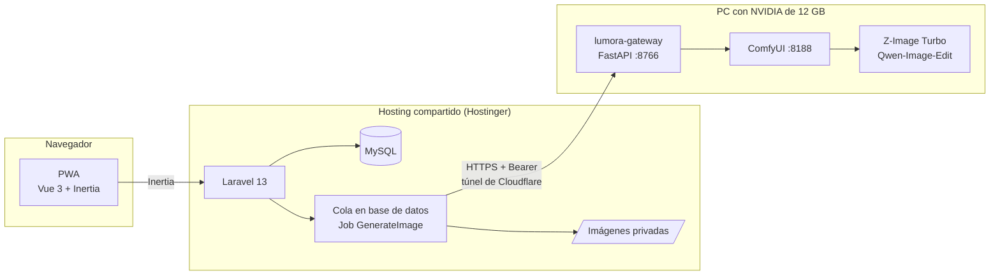

<div align="center">


# Lumora

**Generá y editá imágenes con IA en tu propia placa de video, desde cualquier navegador.**

[](https://github.com/pablomandile/lumora/actions/workflows/tests.yml)


</div>

---

Lumora es un estudio de imágenes con IA al estilo de un chat: escribís lo que querés ver y la imagen llega como respuesta. Hay dos diferencias con los servicios comerciales: los modelos son **abiertos** y corren en una **PC hogareña con una NVIDIA de 12 GB**, y la web vive en un **hosting compartido** común. Las dos partes se conectan por un túnel de Cloudflare, sin abrir puertos.

La app está pensada para un grupo chico: cada persona se registra, el administrador la aprueba y desde ese momento tiene una cuota diaria de imágenes privadas.

## ✨ Qué se puede hacer

- **Generar desde texto** con [Z-Image Turbo](https://huggingface.co/Tongyi-MAI/Z-Image-Turbo): fotorrealista, escribe texto dentro de la imagen y tarda unos 16 s por imagen en una RTX 3060.
- **Editar imágenes con instrucciones** usando [Qwen-Image-Edit-2511](https://huggingface.co/Qwen): subís hasta 3 fotos y pedís el cambio, por ejemplo _«poné la cara de la foto 2 en el flyer»_, _«cambiá el texto por…»_ o _«pasalo a acuarela»_.
- **Estudio como conversación**: cada pedido es un mensaje y cada imagen es la respuesta. Las conversaciones quedan en el menú y se pueden renombrar o borrar.
- **Elegir el formato y la semilla**, pedir otra variante, reintentar o reusar el prompt de una imagen anterior.
- **Galería** con scroll infinito, búsqueda por prompt, favoritas y papelera de 30 días.
- **Visor** con zoom, navegación y descarga en PNG, JPG o WebP.
- **Indicador de la placa en vivo**: muestra si la PC está encendida, ocupada o apagada. Si está apagada, los pedidos esperan en la cola y salen cuando vuelve.
- **App instalable (PWA)** en el celular y en la computadora, con tema claro u oscuro y tamaño de letra a elección.

### Para el administrador

- Aprobación de cuentas nuevas, con aviso por mail.
- Ajustes del gateway (URL, token, probar conexión), cuota diaria, retención de imágenes y estado de la cola.
- Estadísticas de uso de los últimos 7, 30 o 90 días: pedidos por día, uso por modelo y por persona, tiempo de placa, tiempo promedio y espacio ocupado.

### Cuentas y privacidad

- Ingreso con email y contraseña, **Google**, **passkeys** o **doble factor**.
- Las imágenes son **privadas**: se guardan fuera de la carpeta pública y solo las ven su dueño y el admin. Se les borran los metadatos y el EXIF.
- Términos y política de privacidad versionados, descarga de los datos propios en JSON y eliminación real de la cuenta, archivos incluidos.

## 🏗️ Cómo está hecho



1. El navegador manda el pedido. Laravel valida la cuota y crea una **generación** pendiente.
2. Un **Job** en la cola (procesado por un cron, porque el hosting no deja procesos permanentes) se lo pasa al gateway de la PC por el túnel.
3. El **gateway** arma el workflow de ComfyUI, atiende **de a una imagen** y responde enseguida con un `job_id`. Así ningún request queda abierto más que el límite de ~100 s de Cloudflare.
4. El Job sigue el progreso, baja el PNG, genera una miniatura WebP y la guarda en privado. Mientras tanto, la página consulta el estado y muestra el avance.

Algunas decisiones de diseño:

- **ComfyUI y no Ollama.** La generación de imágenes de Ollama solo funciona en macOS. ComfyUI corre todos los modelos abiertos en Windows con NVIDIA y para cambiar de modelo alcanza con cambiar el workflow.
- **La placa se comparte con otras apps.** Antes de cargar un modelo, el gateway le pide a Ollama que libere la VRAM, y descarga ComfyUI tras un rato sin uso.
- **El motor es intercambiable.** Laravel habla con la interfaz `ImageEngine`, y los modelos se describen con datos en la tabla `ai_models` (workflow, valores por defecto, habilitado, solo admin).
- **Tolerancia a cortes.** Si la PC se apaga o el túnel se corta, el Job espera y reintenta, y retoma lo que había quedado a medias cuando se reinicia el worker o el gateway.

## 🧰 Stack

| Capa     | Tecnologías                                                                                                       |
| -------- | ----------------------------------------------------------------------------------------------------------------- |
| Backend  | PHP 8.4, Laravel 13, Fortify (auth, 2FA, passkeys), Socialite (Google), Intervention Image, MySQL                 |
| Frontend | Vue 3 + TypeScript, Inertia 3, Tailwind CSS 4, componentes de shadcn-vue (Reka UI), Lucide, vue-sonner, Wayfinder |
| Build    | Vite+ (`vp`)                                                                                                      |
| PC GPU   | Python 3.11, FastAPI + uvicorn, ComfyUI (Comfy Desktop), cloudflared como servicio de Windows                     |
| Modelos  | Z-Image Turbo fp8 (9 pasos) · Qwen-Image-Edit-2511 GGUF Q4_K_M + LoRA Lightning de 4 pasos                        |
| Calidad  | Pest, Larastan (PHPStan), Pint, `vue-tsc`, pytest en el gateway y GitHub Actions                                  |

## 📁 Estructura

```
app/
├── Jobs/GenerateImage.php        # encola en la placa, sigue el progreso y guarda el resultado
├── Services/ImageEngine/         # cliente del gateway y monitor del estado de la placa
├── Services/Generations/         # creación de pedidos y cuota diaria
├── Services/Images/              # guardado privado, miniaturas y limpieza de metadatos
├── Models/ Policies/ Enums/
resources/js/pages/
├── Studio.vue                    # el estudio (conversación + barra de prompt)
├── Gallery.vue
└── admin/                        # usuarios, ajustes y estadísticas
gpu_worker/                       # lo que corre en la PC con la placa
├── lumora_gateway/               # FastAPI: /health, /generate, /jobs, /inputs
├── iniciar-lumora.bat            # levanta ComfyUI y el gateway con un solo clic
└── README.md                     # guía de instalación paso a paso
routes/console.php                # comandos artisan y tareas programadas
```

## 🚀 Correrlo en local

Requisitos: PHP 8.4, Composer, Node 22 y MySQL (o cambiá a SQLite en `.env`).

```bash
git clone https://github.com/pablomandile/lumora.git
cd lumora
composer setup        # instala dependencias, crea .env, migra y compila
composer dev          # servidor, worker de la cola y Vite a la vez
```

Para tener un administrador, registrate en la app y después corré:

```bash
php artisan lumora:make-admin tu@email.com
```

Sin la PC GPU la app funciona igual: el indicador muestra la placa apagada y los pedidos quedan en la cola. Para conectarla, seguí [gpu_worker/README.md](gpu_worker/README.md) y cargá la URL y el token del gateway en **Ajustes del admin**.

### Comandos útiles

| Comando                                                 | Para qué                                                               |
| ------------------------------------------------------- | ---------------------------------------------------------------------- |
| `php artisan lumora:generate <email> "<prompt>" --wait` | Generar una imagen desde la terminal para probar la placa              |
| `php artisan gpu:probe`                                 | Consultar el estado de la placa (corre cada minuto)                    |
| `php artisan images:prune`                              | Vaciar la papelera y aplicar la retención (todos los días a las 04:00) |
| `php artisan attachments:prune`                         | Borrar las fotos subidas que ya no usa ningún pedido (04:10)           |

## ✅ Tests

```bash
composer test         # Pint + PHPStan + Pest
npm run check         # lint y formato del frontend
npm run types:check   # TypeScript

cd gpu_worker && pytest   # tests del gateway
```

GitHub Actions corre todo en cada push a `main`.

## 🌐 Producción

Lumora corre en un hosting compartido sin Node:

- El código se actualiza con `git pull` en el servidor y el frontend se compila en local y se sube.
- El cron del panel ejecuta `schedule:run` y `queue:work` cada minuto.
- La PC GPU publica el gateway con un named tunnel de Cloudflare. Es el único registro con proxy del dominio.

---

<div align="center">
<sub>Hecho en Argentina 🇦🇷 con Laravel, Vue y mucha VRAM.</sub>
</div>
